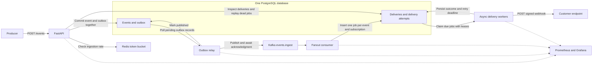

# Relay Reliable Webhook Delivery

Relay accepts tenant events and delivers signed HTTP webhooks to matching subscriptions. Its purpose is to demonstrate durable ingestion, recovery after worker crashes, controlled retries, and inspectable delivery history in a compact backend project.

Status: design contract completed; implementation has not started. All behavior below is a target to implement and verify. Relay is a working name.

**Delivery promise:** An accepted event is persisted before the API acknowledges it. Delivery attempts can be repeated, are bounded by a retry budget, and end in a visible success or failure state. Receivers must deduplicate by delivery ID. Delivery order is not guaranteed.

**First milestone:** An authenticated tenant registers a subscription, submits an event, and sees a successful delivery and attempt record using FastAPI, PostgreSQL, and a local mock receiver.

**Finished portfolio scope:** Tenant API keys, subscriptions, idempotent ingestion, bounded asyncio workers, HMAC signatures, durable retries, crash recovery, failed-delivery replay, Kafka with a transactional outbox, Redis ingestion rate limiting, Docker Compose, Prometheus, Grafana, and reproducible load and failure experiments.

**Deferred features:** Frontend, JWT login, roles, billing, strict delivery ordering, circuit breakers, secret rotation, arbitrary public receiver URLs, Redis Streams comparison, Kubernetes, autoscaling, and tracing infrastructure.

**Target architecture**



The PostgreSQL boxes represent tables in the same database. That database also contains tenants and subscriptions. Kafka buffers accepted events for fanout; PostgreSQL schedules outgoing HTTP requests and retries. Redis is used by ingestion only. The replay API belongs to FastAPI.

**Processing flow**

1. FastAPI authenticates the tenant, validates the request, and checks its Redis ingestion allowance once rate limiting is implemented.
2. FastAPI selects active matching subscriptions and commits the event, recipient IDs, and outbox record together. It returns `202` after the commit.
3. The outbox relay polls unpublished records, publishes event references to `events.ingest`, and marks each record published only after Kafka acknowledges it. Use one relay process initially. A crash between acknowledgment and marking can cause duplicate publication.
4. The fanout consumer loads the event and its saved recipients, inserts one delivery per `(event_id, subscription_id)` in a transaction, and commits the Kafka offset only after that transaction succeeds. Existing deliveries are preserved when the message is processed again.
5. Async workers claim due deliveries using short transactions, row locks, and leases. They send HTTP outside those transactions, then persist the attempt outcome and delivery state together while still owning the lease.
6. Retryable failures receive a persisted `next_attempt_at`. Terminal failures become `dead`. An expired-lease recovery scan makes abandoned work eligible for retry within its remaining budget.
7. The tenant inspects attempts or replays a dead delivery through FastAPI. Replay starts a new run on the existing delivery and preserves its history.

Implement these responsibilities in one repository and one application image, with separate process commands for the API, relay, fanout consumer, and delivery worker. A fanout consumer group distributes ingestion work; delivery workers independently claim jobs from PostgreSQL.

**Incremental implementation**

The first milestone uses `Producer -> FastAPI -> PostgreSQL -> Async worker -> Mock receiver`. FastAPI initially inserts events and deliveries in one transaction. Add retries, signatures, recovery, and replay to this delivery engine before introducing Kafka.

When Kafka is added, replace direct API delivery creation with event/outbox insertion and the fanout consumer. Retain recipient selection at acceptance, delivery uniqueness, worker ownership, and HTTP behavior. Redis and monitoring follow as separate steps. The completed project uses the target architecture above; the smaller flow is an implementation milestone.

**Core terms**

| Term | Meaning |
| --- | --- |
| Tenant | An API-key-authenticated owner of subscriptions and events. |
| Event | One accepted type and payload belonging to a tenant. |
| Subscription | A receiver URL, matching event types, and a signing secret. |
| Delivery | One durable job for one event and one subscription. |
| Attempt | One started execution of a delivery, with a recorded outcome. |
| Run | The initial delivery lifecycle or a later manual replay, each with its own budget. |
| Outbox | Database records that track events awaiting publication to Kafka. |

**Authentication and subscriptions**

- Use `Authorization: Bearer <tenant-api-key>`. Generate keys through a local tenant-seeding command and store only hashes.
- Derive the tenant from the key. Clients cannot select a different tenant through request fields. Scope every resource read and mutation to its owner.
- Subscriptions match exact event-type strings; no wildcard matching in version one.
- Register a URL and a nonempty list of event types. Generate a signing secret and return it once at creation; encrypt it for storage and never include it in list responses or logs.
- URLs and signing secrets are immutable. Subscriptions can be activated or deactivated, but cannot be deleted in version one.
- Deactivation excludes a subscription from future event acceptance. Deliveries for previously accepted events continue.
- Permit configured receiver hosts only, including the local mock receiver. Public receivers require HTTPS; local development may explicitly permit HTTP. Do not follow redirects.

**Event acceptance and idempotency**

```http
POST /events
Authorization: Bearer <tenant-api-key>
Idempotency-Key: order-123-created
Content-Type: application/json

{
  "type": "order.created",
  "payload": {"order_id": "123", "amount": 499}
}
```

Require a nonempty type of at most 100 characters, an object payload, and an idempotency key of 1 to 128 printable ASCII characters. Reject unknown request fields and non-finite JSON numbers. Limit the request body to 64 KiB.

Select active matching subscriptions when accepting the event and persist their IDs. Subscription changes after acceptance do not change its recipients. An event with zero recipients is accepted with a delivery count of zero.

In the first implementation, commit the event and its delivery jobs in one transaction. In the Kafka implementation, commit the event, recipient IDs, and outbox record in one transaction; the fanout consumer creates deliveries later.

Return `202 Accepted` only after the transaction commits:

```json
{
  "event_id": "<uuid>",
  "status": "accepted",
  "delivery_count": 1
}
```

The response acknowledges persistence, not successful delivery. The database enforces uniqueness of `(tenant_id, idempotency_key)`.

- Same key and normalized request: return `202` with the original acceptance response; create no additional event or delivery.
- Same key with different content: return `409 Conflict`.
- The same key used by different tenants represents independent events.
- Retain idempotency keys for the lifetime of their event. Version one has no automatic event deletion or key expiration.
- Normalize the validated type and payload as compact UTF-8 JSON with recursively sorted object keys before hashing. Object-key order and insignificant whitespace are ignored; array order and serialized numeric representations remain significant.

**Delivery states and worker ownership**

```text
pending -> running -> succeeded
                   -> retry_wait -> running
                   -> dead

dead -> pending  (manual replay starts a new run)
```

The database enforces one delivery per `(event_id, subscription_id)`. Different subscriptions have independent outcomes.

Workers claim due jobs in short PostgreSQL transactions using `FOR UPDATE SKIP LOCKED`, assign a lease token and expiry, increment the run's attempt count, and create a started attempt. Send HTTP after committing. Persist the result only while the worker still owns that lease; commit the attempt result and next delivery state together.

An expired lease produces an `unknown` attempt outcome and becomes eligible for retry if the budget remains. Otherwise, it becomes dead. A lease token protects database state from stale worker updates; it cannot guarantee a remote side effect happens only once. Started attempts count toward the budget even if a crash leaves their outcome unknown.

Use a reusable async HTTP client. Claim only jobs that fit available execution slots. Persist future retry deadlines and release slots instead of sleeping until the deadline.

**Failure and retry policy**

| Result | Action |
| --- | --- |
| Any `2xx` | Mark succeeded; the receiver has acknowledged the request. |
| Timeout, connection failure, or temporary DNS failure | Retry. |
| `408`, `429`, or `5xx` | Retry. |
| Other `4xx`, `3xx`, or TLS certificate validation failure | Mark dead with a reason. |
| Attempts exhausted or run deadline reached | Mark dead with a reason. |

Retry with full jitter: `random(0, min(300 seconds, 2 seconds * 2^(attempt_no - 1)))`. For `429` and `503`, parse valid `Retry-After` seconds or HTTP dates and schedule no earlier than both that deadline and the jitter deadline. Invalid headers use normal backoff. If the next attempt cannot start before the run deadline, terminate the run.

| Initial default | Value |
| --- | --- |
| Maximum attempts per run | 5, including the first attempt |
| Maximum run age | 24 hours from acceptance, or from manual replay |
| Total HTTP attempt deadline | 5 seconds |
| Lease duration | 30 seconds |
| Expired-lease recovery scan | Every 5 seconds |
| Concurrent HTTP requests per worker | 20 |
| Concurrent requests per subscription per worker | 2 |
| Maximum subscriptions per tenant | 10 |
| Tenant ingestion rate and burst | 10 requests/second; 20-token capacity |

These configurable defaults are starting points for experiments. Per-worker subscription limits do not establish a global endpoint concurrency cap or strict tenant fairness.

**Webhook identity and signing**

Send an event envelope containing `id`, `type`, `created_at`, and `payload`. Keep the body bytes stable across retries and replay. Each attempt gets a fresh timestamp and signature.

```text
Webhook-Id: <stable delivery UUID>
Webhook-Timestamp: <Unix seconds>
Webhook-Signature: v1=<hex HMAC-SHA256>

signed bytes = timestamp + "." + exact HTTP body bytes
```

The example receiver checks a five-minute timestamp tolerance, uses constant-time signature comparison, and persists deduplication by delivery ID. An HTTP acknowledgment does not prove downstream business processing completed. Repeated requests, including after replay, can reach the receiver; receiver deduplication prevents repeating its demonstrated side effect.

**Inspection and replay API**

| Endpoint | Behavior |
| --- | --- |
| `POST /subscriptions` | Create a subscription; return `201`. |
| `GET /subscriptions` | List owned subscriptions without secrets. |
| `PATCH /subscriptions/{id}` | Change only the active flag. |
| `POST /events` | Accept or deduplicate an event. |
| `GET /events/{id}` | Return the event and delivery summaries, including whether fanout is pending. |
| `GET /deliveries?status=dead` | List owned deliveries with bounded pagination. |
| `GET /deliveries/{id}/attempts` | Return attempt history with bounded pagination. |
| `POST /deliveries/{id}/replay` | Restart a dead delivery; return `202`. |
| `/health/live`, `/health/ready`, `/metrics` | Expose operational endpoints. |

Replay preserves history and delivery ID, increments the run number, resets the run's attempt count, and sets a fresh deadline. Reject replay of a non-dead delivery with `409`; concurrent replay requests can start only one run.

Use `401` for missing or invalid authentication; `404` for absent or foreign-tenant resources; `413` for oversized bodies; `422` for invalid request fields; `429` for ingestion rate rejection; and `503` when ingestion dependencies are unavailable. Error bodies have a stable code and message and contain no internal exception details or credentials.

**Kafka and Redis boundaries**

Kafka has one ingestion topic and one fanout consumer group. A polling relay publishes committed outbox records and marks them published after broker acknowledgment. The consumer commits its offset only after the PostgreSQL delivery-insertion transaction succeeds. Duplicate publication and consumption are handled through delivery uniqueness constraints.

PostgreSQL owns delivery state, deadlines, and failed-delivery history. There are no Kafka retry or DLQ topics. Kafka replay cannot reset an existing delivery; only the replay API starts a new run. A broker outage delays fanout while committed outbox records remain available for later publication.

Redis owns the atomic tenant ingestion token bucket only. Authenticated, validated ingestion requests, including duplicates, consume tokens. When Redis is unavailable, ingestion returns `503`; existing delivery workers continue. PostgreSQL remains authoritative for idempotency.

**Observability**

Use structured logs and one Prometheus/Grafana dashboard covering ingestion rate and latency, successful deliveries, HTTP attempt latency, acceptance-to-delivery latency, retry and dead-delivery counts, due backlog, oldest due-job age, unpublished outbox records, and worker recovery.

Keep metric labels bounded, such as outcome, HTTP status class, and process role. Put tenant IDs, delivery IDs, and receiver URLs in logs and the inspection API rather than Prometheus labels. Endpoint-specific investigation uses delivery history. Full tracing infrastructure is deferred.

**Completion evidence**

The finished project must demonstrate:

- Concurrent duplicate ingestion produces one event and one job per recipient; conflicting content returns `409`.
- Tenant isolation, signature verification, and receiver deduplication work.
- Deterministic receiver failures exercise backoff, `Retry-After`, terminal failures, and replay.
- Multiple workers claim jobs safely; killing a worker leads to recorded recovery after lease expiry.
- A receiver that processes a request before timing out demonstrates duplicate requests and one deduplicated side effect.
- Kafka interruption and relay restarts preserve committed events and do not create duplicate delivery jobs.
- Ingestion and delivery throughput, latency, backlog, and recovery time are measured with reproducible test conditions.
- Docker Compose setup, automated checks, one Grafana dashboard, limitations, and a short demo are documented.

Durability depends on configured PostgreSQL storage. Local volumes demonstrate process/container restart recovery, not recovery from losing the host or database volume. One local Kafka broker does not demonstrate broker high availability. No performance target or completed reliability guarantee is claimed before measurement and verification.
